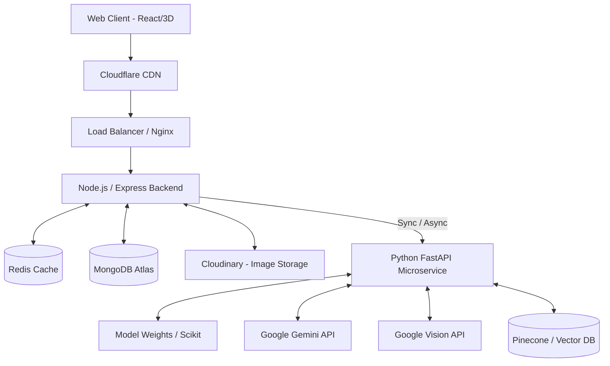

# FinPilot AI - System Design & Scalability

## 1. High-Level Architecture Diagram

## 2. Component Breakdown

### 2.1. Client Layer
*   React SPA served via Vercel edge networks.
*   Heavy 3D assets (GLTF/Spline) are compressed (Draco) and cached heavily via Cloudflare to ensure instant load times.
*   Optimistic UI updates using React Query for perceived zero-latency interactions.

### 2.2. API Gateway & Backend
*   Stateless Node.js processes. Scaled horizontally behind Nginx.
*   **Rate Limiting**: Implemented via Redis to prevent DDoS and API abuse.
*   **Authentication**: Stateless JWTs stored in secure, HTTP-only cookies.

### 2.3. Data Storage
*   **MongoDB Atlas**: Primary operational datastore. Deployed in a replica set for high availability. 
*   **Redis**: Used for caching frequent queries (e.g., dashboard summary stats), managing WebSocket pub/sub, and maintaining rate limit counters.
*   **Vector Database**: Stores embedding vectors of transactions to enable rapid similarity search for the LLM context (RAG).

### 2.4. Background Processing (Message Queue)
*   **Queue**: BullMQ (running on Redis).
*   **Workers**: Handle heavy tasks outside the HTTP request-response cycle.
*   **Use Cases**:
    *   Processing receipt OCR.
    *   Generating end-of-month PDF reports.
    *   Triggering batch ML training scripts.

## 3. Scalability Strategy

*   **Horizontal Scaling**: Both Node.js and Python services are Dockerized. They can be scaled horizontally using Kubernetes or cloud platforms like Render/AWS ECS.
*   **Caching Strategy**: 
    *   Dashboard aggregates (Total Income, Total Expense) are cached in Redis and invalidated on new transaction creation.
    *   API responses for static assets and unchanged lists are cached at the CDN level.
*   **Database Indexing**: Compound indexes on `(userId, date)` and `(userId, categoryId)` ensure sub-millisecond query times even with millions of transaction records.

## 4. Resilience & Fault Tolerance
*   **Circuit Breakers**: Implemented on the connection between Node.js and the Python ML service. If the ML service goes down, the core app (adding transactions manually) remains functional.
*   **Retries**: Exponential backoff for external API calls (Gemini API, Google Vision).
*   **Graceful Degradation**: If 3D components fail to load or WebGL is unsupported, the UI gracefully falls back to high-quality 2D CSS animations.
